<div align="center">

# Catalyst — Android app

**Money meets _mood_.** Track every taka against how the day actually felt.

[](https://github.com/HAVIC-47/catalyst-app/releases/latest/download/Catalyst.apk)
&nbsp;
[](https://github.com/HAVIC-47/catalyst-app/releases/latest)

**Direct download (latest version):** https://github.com/HAVIC-47/catalyst-app/releases/latest/download/Catalyst.apk

Android 7.0+ · Flutter · same account and data as the [Catalyst web app](https://catalyst-hishab.vercel.app)

</div>

<p align="center">
  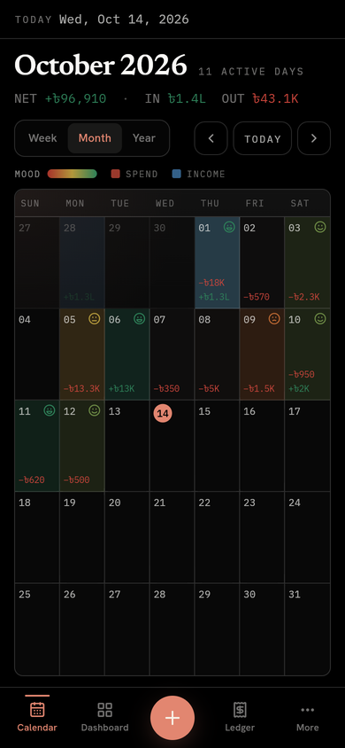
  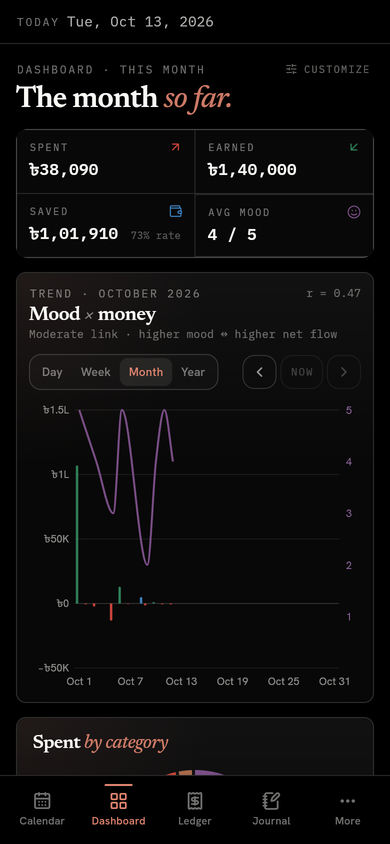
  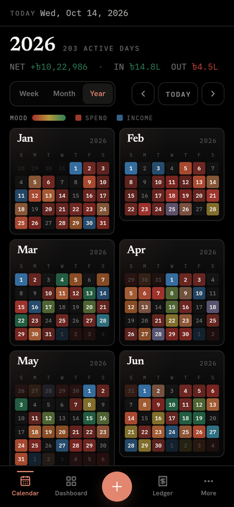
</p>
<p align="center">
  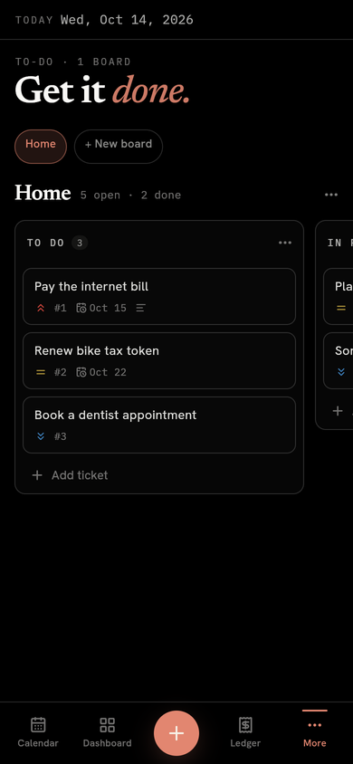
  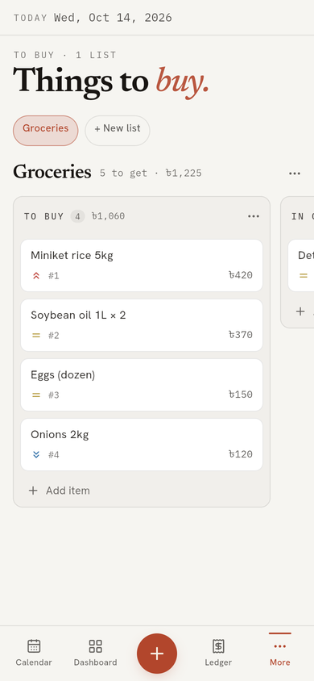
  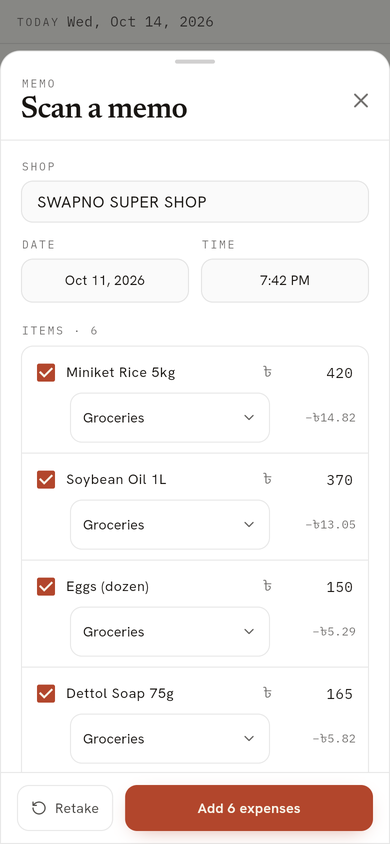
</p>
<p align="center">
  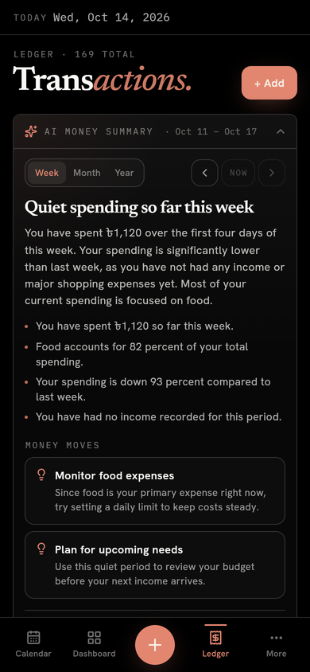
  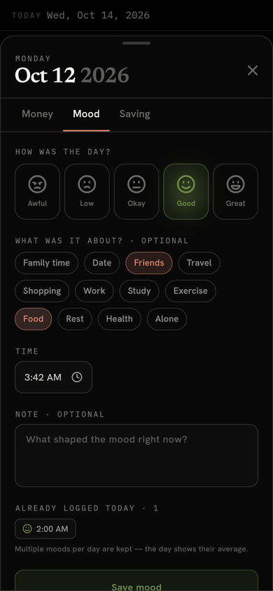
  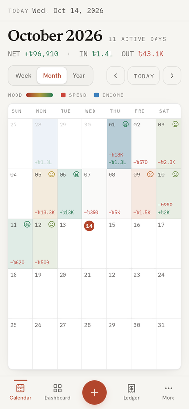
</p>
<p align="center">
  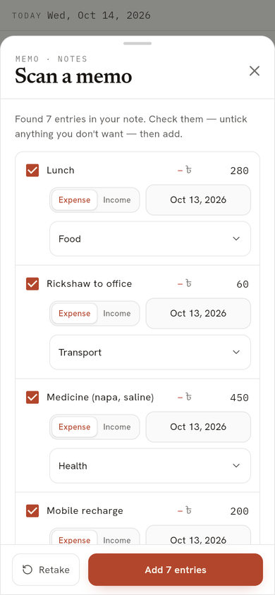
  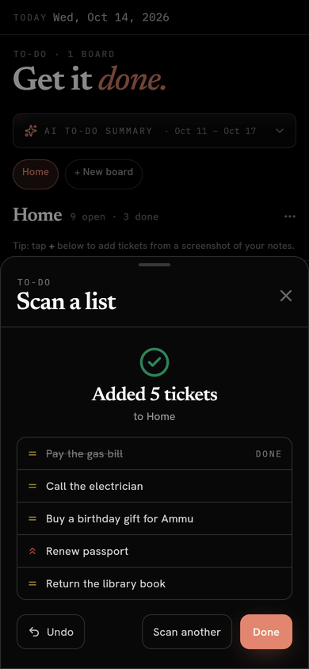
  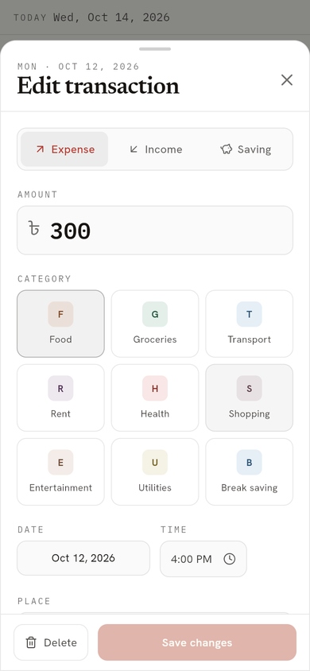
</p>
<p align="center">
  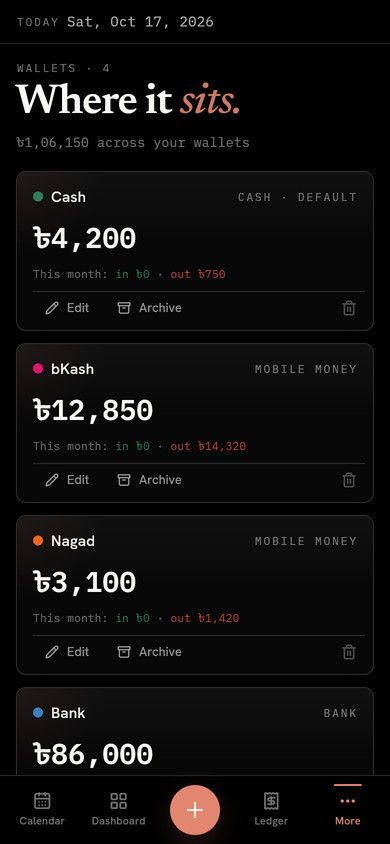
  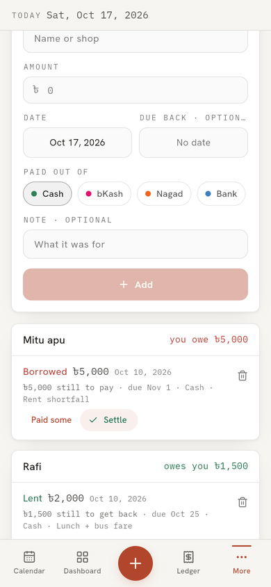
  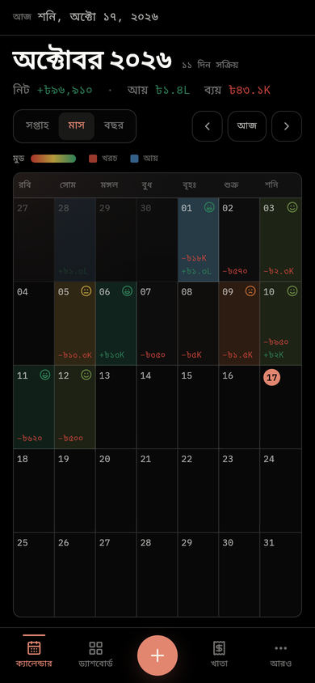
</p>

## Install

1. On your phone, open the **[direct download link](https://github.com/HAVIC-47/catalyst-app/releases/latest/download/Catalyst.apk)**
   (or download it on a computer and send it over USB, Drive, Telegram…).
2. Open the downloaded `Catalyst.apk`. Android asks once to allow installs from your browser or
   file manager — allow it, then tap **Install**.
3. Log in with your Catalyst account, or create one.

The download is a universal APK (~60 MB) that runs on any Android phone. A smaller build for
modern 64-bit phones, [`Catalyst-arm64.apk`](https://github.com/HAVIC-47/catalyst-app/releases/latest/download/Catalyst-arm64.apk) (~22 MB), is attached to every
[release](https://github.com/HAVIC-47/catalyst-app/releases).

**Updating:** install the newer APK over the old one — your data lives in the cloud, nothing is lost.
From 1.4.0 the app tells you when a new version is out: tap **Update** and the new APK downloads.

**New in 1.4.1:** bKash / Nagad messages come in by **Share** — press and hold one in your Messages app, tap
Share, then Catalyst (or copy it and paste it in Settings). The app no longer asks to read SMS, so Android's
Play Protect doesn't block installing it any more.

**1.4.0:** **Wallets** (Cash, bKash, Nagad, Bank — what's in each, and transfers between them),
**Dhar / baki** (money lent and borrowed, part payments, settle), **bills that log themselves** (tick one when
you pay it and the expense is added, then it moves to next month — with Undo), **reminders** on your phone
(evening check-in, bills and dhar due tomorrow, budgets at 80% / 100%), works **offline** (everything is kept
on the phone; entries and moods made offline sync later), a **home-screen widget** (today's spending and a
quick +), **bKash / Nagad** message suggestions (read on the phone only), an **AI monthly recap**,
**currency** choice, the whole app in **বাংলা**, and **Forgot password**, Google sign-in and **Delete account**.
Also a **new logo**, **About the app** in Settings, and a **What's new** pop-up after each update.

**1.3.0:** the **+** reads screenshots too. Choose a screenshot of your notes (Notepad, any notes
app) with expenses and income and they're added to your ledger — categories the note names that you don't
have yet are created for you, and you're told which. On **To-do** and **To buy**, **+** adds a whole list
from a screenshot straight onto the board (with Undo), and both boards get an **AI summary**. And every
transaction in the **Ledger** now has a pen: edit anything about it, and every total updates.

**1.2.1:** board columns move too — press and hold a column's title, then drag it left or right.

**1.2.0:** **To-do** and **To buy** boards — Jira-style columns you drag tickets across (press and
hold a ticket); **AI summaries and suggestions** for your money, savings, goals, bills, journal and mood, by
week, month or year; and a new bottom bar — Calendar · Dashboard · **+** · Ledger · More, where **+** opens
the memo scanner and Journal now lives in More. Install it over the older version — you stay logged in.
[Release notes](https://github.com/HAVIC-47/catalyst-app/releases/latest)

## One account, two apps

The app talks to the **same Supabase backend** as the [web app](https://github.com/HAVIC-47/catalyst)
([live](https://catalyst-hishab.vercel.app)). Log in with the same email and you see the same
transactions, moods, budgets, goals, bills, wallets, dhar, journal and boards — and the same settings
(language, currency, reminders, dashboard sections). Anything added on one shows up on the other —
pull down to refresh, or just reopen the app.

## Features

- **Calendar** — week, month and year views. Every day is tinted by its mood and by heavier spend or
  income, with a mood face and the day's amounts. The month view always fits one screen; the year view
  is a 12-month heatmap. Tap any day to log money or mood.
- **Dashboard** — this month's spent / earned / saved / average mood, a mood × money trend (net cash
  flow bars against the mood line, with correlation), and charts for spending and income by category,
  mood distribution, savings, mood tags and category frequency. Choose which sections to show in
  Settings — the choice is shared with the web app.
- **Ledger** — every transaction grouped by day, with search (note, category, place, amount, even
  "october" or "monday") and filters by type, period or date range, category and amount. Tap the pen on
  any transaction to change its type, amount, category, date, time, place or note (or delete it) — every
  total in the app follows straight away.
- **Memo scanner** — tap **+** in the middle of the bottom bar and take a photo of a memo/receipt, or choose
  a photo or a screenshot of your notes (Notepad, any notes app) with expenses and income. Check what it found,
  then save: a memo's items — plus VAT or service charge — each become an expense, with any discount shared
  out; a note's lines become expenses and income, and categories it names that you don't have yet are created
  for you. Reads Bengali and English, printed or handwritten.
- **To-do and To buy** — Jira-style boards in More: status columns (To do → In progress → Done; To buy →
  In cart → Bought), numbered tickets with priority, due date, notes and — on to-buy lists — a price. Press and
  hold a ticket to drag it within or across columns, or a column's title to move the column left or right (the
  board scrolls when you reach an edge); tap a ticket to edit it. On a board, **+** adds a whole list from a
  screenshot of your notes — every item goes straight onto the board (ticked ones as done or bought), with Undo.
- **AI summaries and suggestions** — a weekly, monthly or yearly read of your ledger, savings, goals, bills,
  journal, mood and to-do and to-buy boards, with suggestions to manage money, save more, feel better or get
  through the list — on each of those screens and the dashboard. Written by Gemini on the web app's server and saved, so the web and the app show the same one.
- **Quick entry** — expense and income in one go, five moods with context tags (work, family, travel…),
  and savings; each with a time, place and note.
- **Budgets** — monthly limits per category that fill up as you spend and turn red when you go over, with
  alerts at 80% and 100%.
- **Goals** — savings targets with progress bars and quick additions.
- **Bills** — due dates, recurrence, overdue / due-soon warnings. Tick a bill when you pay it: the expense goes
  into the ledger (its category, from its wallet) and a repeating bill moves to its next due date — Undo takes
  both back.
- **Wallets** — where the money sits: Cash, bKash, Nagad and Bank to start (rename, add, archive). Each shows what's
  in it now; every entry picks its wallet; transfers move money between wallets without counting as spending, and
  a fee (a bKash cash-out) is logged as an expense.
- **Dhar / baki** — money you lent or borrowed, grouped by person: part payments, settle in full, write off.
- **Reminders** — scheduled on the phone, so they work offline: an evening "how was today?" when no mood is logged,
  the day before a bill or dhar is due, and budget alerts. Settings has the switches and the check-in time (shared
  with the web).
- **Offline** — the app keeps a copy of your data on the phone, so it opens on everything with no connection. Money
  entries and moods you add (or edit, or delete) offline — for any day, month or year — wait on the phone and sync
  in order once you're back online; a banner shows what's waiting.
- **Home-screen widget** — today's spending at a glance, and a **+** that opens a new entry.
- **bKash / Nagad messages** — share a confirmation message to Catalyst (press and hold it in your Messages app →
  Share → Catalyst) or paste it in Settings, and the app suggests the entry (payments, send money, received,
  recharge, bills) or transfer (cash in / out, add money, to bank). Nothing is saved until you review and add; the
  message is read on the phone and never leaves it. No SMS permission is needed.
- **AI monthly recap** — on the dashboard: the month (or year) in one read, with what to do differently next time.
- **Journal** — a daily log with a mood, plus custom habits to tick off each day.
- **Vault Mode** — count all income and spending against your savings pool.
- **Currency** — taka by default; Settings switches how amounts are written (dollar, Canadian dollar, euro, rupee…).
- **বাংলা** — the whole app in Bangla, with Bengali dates and digits (Settings → Language, or on the login screen).
- **Account** — forgot password (the email's link opens the app to set a new one), optional Google sign-in,
  and Delete account (Settings).
- **Updates** — a banner when a new version is on GitHub; **Update** downloads it. The first launch after an update
  pops up what's new.
- **About the app** — Settings lists everything the app does, with what's new in this version on top.
- **Dark and light themes** — dark by default, the same design as the web.

## Build from source

Requirements: [Flutter](https://docs.flutter.dev/get-started/install) 3.47+, JDK 17 and the Android SDK.

```powershell
git clone https://github.com/HAVIC-47/catalyst-app.git
cd catalyst-app
copy env.example.json env.json     # then fill in your Supabase URL + anon key
.\build_apk.bat                    # -> dist\Catalyst.apk
```

`build_apk.ps1` options: `-Small` builds the 64-bit-only APK, `-Install` installs it on a phone
connected over USB (with USB debugging on). Release builds are obfuscated; keep `build\symbols` if
you want to read crash stack traces later.

To run on a connected phone or emulator while developing:

```powershell
flutter run --dart-define-from-file=env.json
```

### Configuration

`env.json` (git-ignored) holds the Supabase project the app connects to — the same values as the web
app's `NEXT_PUBLIC_SUPABASE_URL` / `NEXT_PUBLIC_SUPABASE_ANON_KEY`:

```json
{ "SUPABASE_URL": "https://YOUR-PROJECT.supabase.co", "SUPABASE_ANON_KEY": "your-anon-key", "GOOGLE_SIGN_IN": "off" }
```

Set `"GOOGLE_SIGN_IN": "on"` once the Google provider is set up in Supabase. Password-reset and Google sign-in
come back into the app through `com.havic47.catalyst://login-callback` — add it to Supabase → Authentication →
URL Configuration → Redirect URLs (see the web repo's README).

The memo scanner sends photos to the web app's `/api/scan-memo`, the list scanner to its `/api/scan-list`,
and the AI summaries call its `/api/ai-insights` (set `API_BASE_URL` to point them elsewhere; it defaults to
the live site), with the user's login token. The Gemini key lives only on that server — it is never in this repo or the APK.

The anon key is public by design; every table is protected by row-level security, so each account
only ever sees its own rows. The database schema and its hardening live in the web repo
(`db/supabase.sql`, `db/security.sql`).

### Permissions

`POST_NOTIFICATIONS` (asked once, for reminders) and `RECEIVE_BOOT_COMPLETED` (puts scheduled reminders back after
a restart). No SMS permission: Play Protect blocks sideloaded apps that ask for one (1.4.0 did, for reading
bKash / Nagad messages), so from 1.4.1 a message reaches the app only when the user shares or pastes it — the
`SEND` / `text/plain` share target on `MainActivity`.

### Releasing

Bump `version:` in `pubspec.yaml`, add what the release brings to `releases()` in `lib/data/features.dart`
(the What's new pop-up and the top of About — a test fails until the new version has its notes), and tag the
GitHub release `v` + that version (e.g. `v1.4.0`), with `Catalyst.apk` attached: the in-app update banner
compares the installed version with the latest release and downloads its `Catalyst.apk`.

### Logo

The launcher icon has a light and a dark version: `mipmap-*` (white mark on red-orange, `values/colors.xml`) and
`mipmap-night-*` (terracotta mark on near-black, `values-night/colors.xml`). Launchers that follow the system's dark
mode switch between them; others keep the one shown when the app was installed or updated. Inside the app the logo
follows the app's theme (`assets/brand/`).

### Signing

Release builds are signed with the keystore named in `android/key.properties`. Both files are
git-ignored — without them the build falls back to the debug key, which installs fine but can't
update an app that was signed with the release key.

## Project structure

```
lib/
  main.dart            app entry, auth gate, themes
  config.dart          Supabase settings (from env.json at build time)
  models.dart          domain types — mirror the web's src/types
  data/repo.dart       Supabase queries — mirror the web's src/lib/db
  data/app_state.dart  central store — mirrors the web's useAppData
  data/secure_session_storage.dart  login session in Keystore-encrypted storage
  data/insights.dart   AI summaries client (the web's /api/ai-insights)
  data/offline.dart    offline copy of the data + the outbox for entries made offline
  data/money_db.dart   the database calls behind bills, wallets, transfers and dhar
  data/account.dart    delete account (the web's /api/account/delete)
  data/features.dart   what the app does (About the app) and what each release brought (What's new)
  services/            reminders (local notifications), update check, what's new, home-screen widget, bKash / Nagad messages
  screens/wallets_screen.dart, dhar_screen.dart, sms_review_sheet.dart
  screens/about_screen.dart  About the app and the what's-new pop-up
  util/money.dart      wallet balances, next due dates, what a bill is logged as — the web's lib/money.ts
  util/i18n.dart       tr() and Bengali digits; util/bn.dart holds the Bangla text
  util/currency.dart   the account's currency
  data/scan.dart       photo picker + the web's photo readers (/api/scan-memo, /api/scan-list)
  screens/memo_sheet.dart  memo scanner: memo -> one expense per item; notes -> expenses, income, new categories
  screens/list_scan_sheet.dart  list scanner: screenshot of a list -> tickets on the board, with Undo
  screens/boards_screen.dart  To-do / To buy boards with drag and drop
  widgets/ai_insights.dart  the AI summary card
  widgets/scan_ui.dart  pieces shared by the two scanners
  util/limits.dart     text length limits (same as the database checks)
  theme/               design tokens (same values as the web's globals.css)
  widgets/             cards, buttons, segmented controls, charts, mood faces
  screens/             one screen per web page, plus the entry sheet and app shell
android/…/MainActivity.kt   the share target (bKash / Nagad messages) and widget channels
android/…/CatalystWidget.kt the home-screen widget
build_apk.ps1          release build script (build_apk.bat to double-click)
```

## Tech

Flutter 3.47 · Dart 3.13 · [supabase_flutter](https://pub.dev/packages/supabase_flutter) ·
provider · [Lucide](https://lucide.dev) icons · charts drawn with `CustomPainter` ·
fonts: Newsreader, Hanken Grotesk and IBM Plex Mono (SIL Open Font License, bundled in `assets/fonts`).
